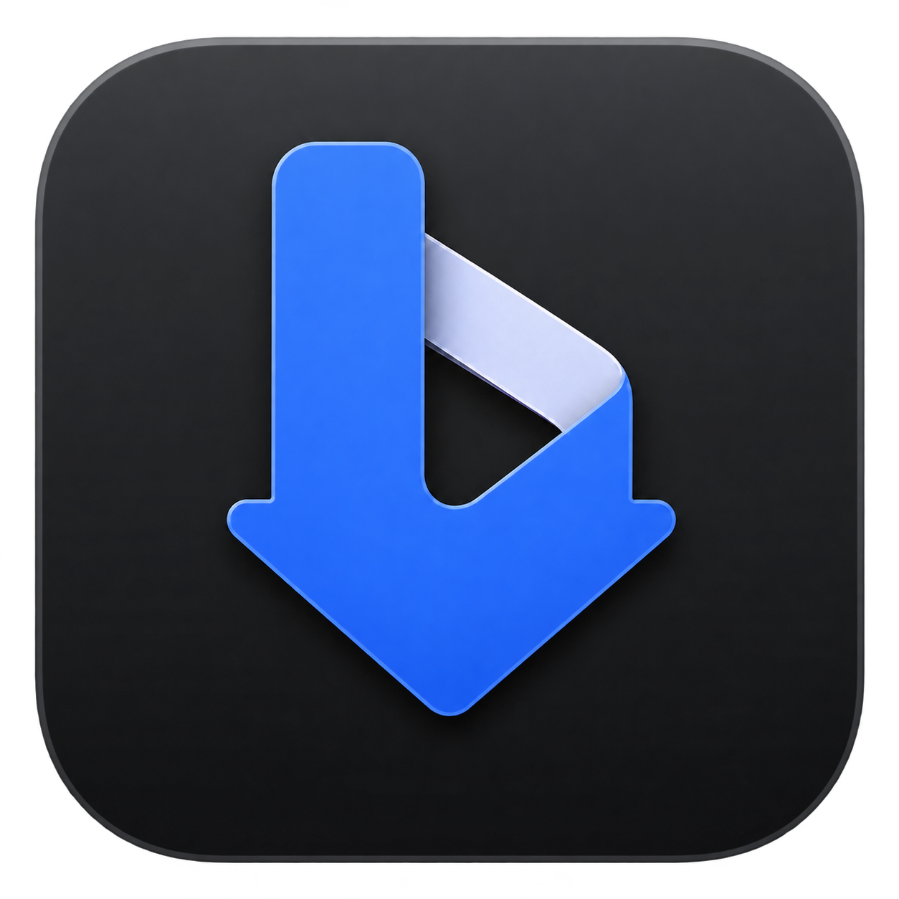
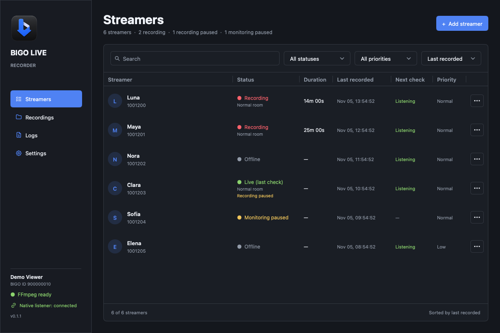

<h1 align="center">
  <a href="https://github.com/SamiNassim/bigo-live-recorder/releases">
    
  </a>
  <br>
  BIGO Live Recorder
</h1>

<p align="center">
  <a href="https://awesomemygo.dev/apps/bigo-live-recorder"></a>
</p>

Automatically record BIGO livestreams on Windows, macOS, and Linux. Recordings
stay on your computer, in their original quality, with no re-encoding.

One BIGO account is used for both live notifications and recording. You only need
your browser for the initial setup: no browser or phone needs to stay running.



## Download and open

Download the version for your operating system and processor from this repository's
**Releases** page. You do not need Go to run the app.

Releases do not use verified Apple or Windows publisher certificates, and macOS
builds are not notarized by Apple. Your computer may warn you on first launch.
Only continue if you trust the source of the download.

### macOS

1. Open the downloaded `.dmg` and drag **BIGO Live Recorder** to **Applications**.
   If you downloaded a `.zip` instead, extract it and move the app to **Applications**.
2. Try opening the app once. If macOS says the developer cannot be verified or
   Apple cannot check it, dismiss the warning.
3. Open **System Settings → Privacy & Security**, scroll to **Security**, and click
   **Open Anyway** beside the message about BIGO Live Recorder. Confirm **Open**
   and authenticate if asked.

This makes an exception for this app; do not disable Gatekeeper system-wide.
See [Apple's instructions](https://support.apple.com/en-us/102445).

### Windows

Download and run the portable `.exe`. No installation is needed. If Windows displays
**Windows protected your PC**, choose **More info → Run anyway**, if available.
An unsigned release may show **Unknown publisher**.

Some Windows security settings or work/school policies block unsigned apps
entirely. Do not turn off system-wide protections to work around that restriction.
See [Microsoft's explanation](https://learn.microsoft.com/en-us/windows/apps/package-and-deploy/smartscreen-reputation).

### Linux

On Debian/Ubuntu, install the `.deb` with your package manager. Alternatively,
extract the `.tar.gz`, open a terminal in the extracted folder, and run:

```sh
chmod +x bigo-live-recorder
./bigo-live-recorder
```

## Quick setup

1. Open the app. If FFmpeg is missing, choose **Download and install** when prompted.
   FFmpeg is the program that saves your recordings; the app sets it up for you.
2. Connect your BIGO account using the [cookie instructions below](#connect-your-bigo-account).
3. In **Settings**, choose your recording folder, leave **Native live notifications**
   enabled and **Stream quality** set to **Origin (native)**, then click **Save settings**.
4. Open **Streamers → Add streamer**. Enter a BIGO ID or profile
   URL. For example, `123456789` and `https://www.bigo.tv/123456789` both work.
   A custom name is optional.
5. Check the listener status in the bottom-left corner and in **Settings**.
   Once connected, the ready subscription count should match your monitored streamers.

The app checks an added streamer and records if they are already live. Otherwise,
it waits for a live notification and checks that the stream can be played before
starting a recording. Keep the app running while you want to monitor or record.

**When native monitoring is enabled, adding or monitoring a streamer automatically
follows them using the account associated with your saved session and enables
their individual live notices.** Make sure live notifications are also enabled
in that BIGO account's settings.

## Connect your BIGO account

**We strongly recommend creating a brand-new BIGO account exclusively for this
app, rather than using your personal account.**

A cookie is a saved sign-in value. You only need to copy one value, called `uniqid`:

1. Sign in at [bigo.tv](https://www.bigo.tv) in Brave or Chrome.
2. Open **Developer Tools**: press F12 on Windows/Linux, or use
   **View → Developer → Developer Tools** on macOS.
3. Open **Application**. In the left sidebar, expand **Cookies** under **Storage**
   and select `https://www.bigo.tv`.
4. Find `uniqid` and copy its **Value**. Copy the value only, not the cookie name
   or the entire table row.
5. In the app, open **Settings → BIGO account** and paste it into the cookie field.
   Wait for your account name and BIGO ID to appear. Use **Validate account** if
   you need to try again, then click **Save settings**.

You can now close the BIGO browser tab; do not sign out to close it. Use this
account in only one native listener at a time. Another app or browser connected
with this account can disconnect this app.

The account connected here follows each monitored streamer when native monitoring
is enabled. Polling-only mode does not automatically follow accounts.

The same cookie works for native notifications, polling, and recording. There is
no second session to capture. If BIGO expires or revokes your sign-in, repeat these
steps to replace the cookie.

## Choose how to monitor

Change these options in **Settings → Monitoring**, then click **Save settings**:

- **Native notifications only (default):** leave **Native live notifications** on
  and **Enable polling backup** off. The app listens for BIGO events instead of
  repeatedly checking offline streamers. If the listener disconnects, the app
  retries the connection; it does not silently turn on polling.
- **Native notifications with polling backup:** enable both switches. The app
  listens for events and also checks streamers periodically, even while connected.
- **Polling only:** turn **Native live notifications** off. The app checks
  streamers periodically without using the native listener.
  **This method is currently highly inconsistent**: live streams can be missed
  or playable URLs may be unavailable. It is not recommended as the primary
  monitoring method for now.

BIGO can delay or miss native notifications. Polling backup adds periodic checks
but is subject to the same current polling limitations. Neither method can
guarantee access to every stream.

The **Polling queue** panel is greyed out and cannot be edited in native-only mode.
It becomes available when polling is enabled, without losing your saved values.
Default polling intervals are 75 seconds for normal-priority streamers, five
minutes for low-priority streamers, and two seconds between requests. The queue
calculator estimates the actual cadence for your list; a larger list or slow
responses can make checks take longer. Change a streamer's priority from its **…** menu.

Native-only mode still makes initial checks on startup and after settings changes,
and checks when you add/resume a streamer or receive an event. Short, bounded
retries may follow a live signal or recording interruption. Healthy active
recordings are not polled; their audio and video continue downloading normally.

## Pause and resume

Open the **…** menu beside a streamer:

- **Pause recording** finishes the current file and prevents new recordings.
  Monitoring stays active, so the app can still show the last checked live/offline
  status. **Resume recording** checks immediately and starts a new file if live,
  even during the same broadcast. You do not need to remove and re-add the streamer.
- **Pause monitoring** stops checks and native subscriptions for that streamer,
  and finishes any active recording. **Resume monitoring** starts checks again.

These are separate preferences, and both are remembered after restarting the app.
If both are paused, resume both to record again. Resuming does not append to an
already finished file.

In native-only mode, **Live (last check)** is the last confirmed state, not a
continuous guarantee that the streamer is still live. Hover over the status to
see when it was last verified. Pausing recording does not enable extra polling.

## Recordings

- Recordings are saved as **MKV**, copying the original audio and video without
  re-encoding. Each file contains short internal clusters for better crash recovery;
  these are not separate chunk files.
- **Settings → Recording → Stream quality** defaults to **Origin (native)**.
  It requests BIGO's native source using the same login as the listener, including
  HEVC when supplied. No browser or emulator is needed. If native media cannot
  start, the app tries the web stream and keeps retrying Origin while it records.
  It waits 30 seconds before the first retry, then 60 seconds, then up to two
  minutes between later attempts; connection setup adds to those waits. It switches
  once native video and audio are ready, starting a new file for the Origin feed.
  Choose **Web (automatic)** to always use the
  web player rendition. Polling-only mode uses the web stream.
- Filenames start with the BIGO ID. Streamer folders start with the BIGO ID,
  followed by the display name. Existing files and folders are not renamed.
- During a temporary playback interruption, the app reconnects and renews playback
  access while keeping the same recording file open when compatible media returns.
  If recovery fails or requires another video codec, it finishes the file and
  checks the stream again. Media that BIGO no longer serves cannot be recovered.
- Quit the app normally to let recordings finish and become easy to seek. A crash
  can still lose buffered data or the last cluster; recovery is not a zero-loss guarantee.
- Enable **Create a processed copy with FFmpeg** in Settings to create a separate
  MKV, MP4, or TS after recording. The original MKV is always kept.
- Use **Recordings → Open recordings folder**, or **Show** beside a file, to find
  your recordings. Removing a streamer never deletes their existing files.
  Files deleted outside the app disappear from finished recording history within
  about five seconds, as long as their recording folder is available.

The default folder is `Movies/BIGO Live Recorder` inside your user folder. Changing
the recording folder affects future recordings; it does not move existing files.
Desktop alerts can be turned off with **Settings → Application → Notify when recording starts**.

### Multi-guest rooms

Each multi-guest broadcast gets its own folder. The app saves individual guest
files: video with audio when a camera is on, and audio-only files otherwise.
Guest changes and media format changes can create additional files. Original
guest recordings are always kept.

In **Recordings**, expand the broadcast row to see the combined replay and all
guest files. Each guest's username appears above **Audio · BIGO ID** or
**Video · BIGO ID**.

After the room ends or changes mode, the app reconciles its saved timing
information and creates a combined replay video. This viewing copy is rendered
separately from the original media. A blue border and meter indicate likely speech for both
camera and audio-only guests. Quiet noise and brief sounds are filtered, but
music or background voices can still activate the indicator.

If recording resumes in the same broadcast, **Replay** opens the last completed
version until the next rebuild finishes. The video does not grow during playback:
a rebuilt and validated replay replaces the previous file. Use the broadcast's
right-click menu to **Rebuild room replay** after its guest recordings finish.

### Split long recordings

In **Settings → Recording → Split recordings every**, choose **30 minutes**,
**1 hour**, or **Custom** and enter a duration in minutes. The default is **Off**.
Save the setting before starting a recording. The recorder saves each clip as it
goes, in one folder per broadcast. Expand the broadcast in **Recordings** to open
completed clips while the stream is still live. The group shows the full recording
span, and each clip has its own duration. Video splits at a keyframe.
If you enable optional FFmpeg processing, it runs for each completed clip.

### Optional FFmpeg processing

Choose **Settings → Recording → Create a processed copy with FFmpeg**, then select
**mkv**, **mp4**, or **ts** in **Processed copy format**.

The **FFmpeg output options** field accepts output options only. The app supplies
the input MKV, output path, and executable; it never runs a shell. The default
copies the original audio and video without re-encoding:

```text
-map 0:v? -map 0:a? -c copy
```

For an MP4 copy with fast start:

```text
-map 0:v? -map 0:a? -c copy -movflags +faststart
```

Do not enter `ffmpeg`, `-i`, input/output paths, or placeholders. Mapping, codecs,
bitrate, filters, and muxing options are supported. Extra inputs, output paths,
scripts, and file attachments are rejected.

Processing runs in the background after recording finishes. It does not block
monitoring or the next recording. Quitting cancels queued and running processing;
the original MKV stays untouched, including after failure or cancellation. Copies
use `.processed.mkv`, `.processed.mp4`, or `.processed.ts`; the recording's
right-click menu can open or reveal an available copy.

An old enabled MP4 conversion preference is migrated to an MP4 processed copy.
The old automatic-deletion option is removed. Existing recordings are not changed.

## Troubleshooting

- **Account validates, but monitoring is not ready:** validation only confirms your
  sign-in. Check the native listener status and ready subscription count separately.
  A yellow status means it is connecting, retrying, or not fully ready. Make sure
  BIGO live notifications are enabled and close other listeners or BIGO browser
  tabs using the same account. Check **Logs** if it keeps retrying.
- **A streamer is live but nothing records:** check that neither monitoring nor
  recording is paused, and that FFmpeg is ready. Check **Logs** for playback errors.
  A valid account does not guarantee a playback URL or access to private/paid rooms.
  Polling backup can catch a missed notification, but cannot force BIGO to supply media.
- **FFmpeg is missing:** open **Settings → Recording → Install FFmpeg…**.
  If you already installed it, leave the **FFmpeg executable** field blank to use
  automatic detection, or use **Choose FFmpeg…** to select it. Click **Save settings**.
  **Check again** tests the selected executable.
- **A cookie stops working:** copy a fresh `uniqid` from your signed-in browser,
  validate it, and save it again. Do not share one account between simultaneous listeners.

The guided FFmpeg installation needs no administrator access and does not change
your system PATH. It downloads a checksum-verified build for supported platforms,
stores it in the app's configuration folder, and fills in the executable path.
If automatic installation is unavailable, install FFmpeg yourself and select it.

## Local files and logs

Use **Settings → Application → Open configuration folder** to open the right folder
on your computer. Its default location is:

- macOS: `~/Library/Application Support/BIGO Live Recorder`
- Windows: `%AppData%\BIGO Live Recorder`
- Linux: `$XDG_CONFIG_HOME/BIGO Live Recorder`, or `~/.config/BIGO Live Recorder`

It contains:

- `config.json`: settings, your BIGO cookie, window position, and generated device identity.
- `data.json`: streamers, pause preferences, and up to 2,000 recording-history entries.
- `bigo-live-recorder.log` and two rotated backups (`.log.1`, `.log.2`): persistent
  logs, capped at 5 MiB each. Old logs are replaced automatically.
- `bigo-live-recorder-crash.log`: diagnostic stack traces for unexpected Go
  panics, with two archived reports (`.log.1`, `.log.2`). Normal restarts preserve
  earlier reports. Startup and normal shutdown are recorded in the main log.
- `bin/`: the app's FFmpeg installation, if you used guided setup.

The **Logs** tab shows the latest 5,000 retained entries, newest first. Search and
level filters apply to the full retained set, not just the visible rows.
**Clear view** clears the displayed entries without deleting the log files.
**Open log folder** opens the same configuration folder.

Your cookie is stored locally in `config.json`, not an OS keychain. Do not share
that file; review logs and data files before sharing them too.

## Building from source

Requires Go 1.27.2 or later. There is no JavaScript toolchain or frontend build.

```sh
go run .
go test -race ./...
go vet ./...
go tool mygo build
```

Cross-platform packages:

```sh
go tool mygo build -platform darwin/arm64,windows/amd64,linux/amd64
```

`go run . -preview` shows synthetic sample data with monitoring and recording
disabled. Build artifacts are placed under `build/` and are not source files.

## Notice

Always obtain the streamer's consent before recording, and their permission
before sharing or publishing a recording. Respect their privacy, applicable
laws, and BIGO's terms of service.

BIGO Live Recorder is an independent project developed for educational purposes.
It is not affiliated with, sponsored by, or endorsed by BIGO. Its educational
purpose does not grant permission to record or redistribute someone else's content.

## Donate

- **ETH:** `0x1739eF0cB6aF1E8188A727B73EDeA9B4aa12187f`
- **SOL:** `G13EVpg5dK4vKBDth8iC7K1xd2xY9qTVAREbh57JdvaE`

## Credits

- [The Go Programming Language](https://go.dev/) — [License](https://go.dev/LICENSE)
- [mygo](https://github.com/egoist/mygo) — [EGOIST](https://github.com/egoist) and contributors — [License](https://github.com/egoist/mygo/blob/v0.6.3/LICENSE)
- [ffmpeg](https://ffmpeg.org/) — [Licensing](https://ffmpeg.org/legal.html)

See [CREDITS.md](CREDITS.md) for the included notices.

## License

[MIT](LICENSE).
